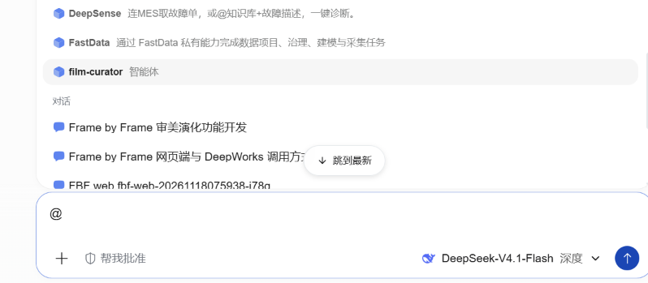
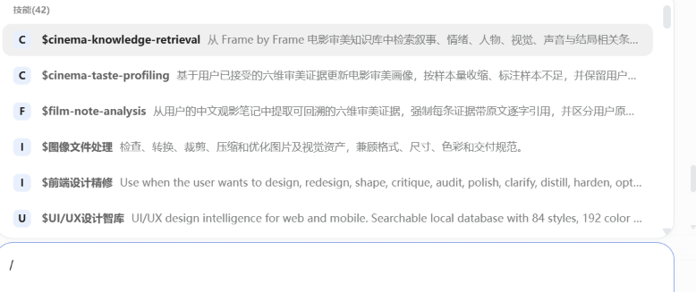
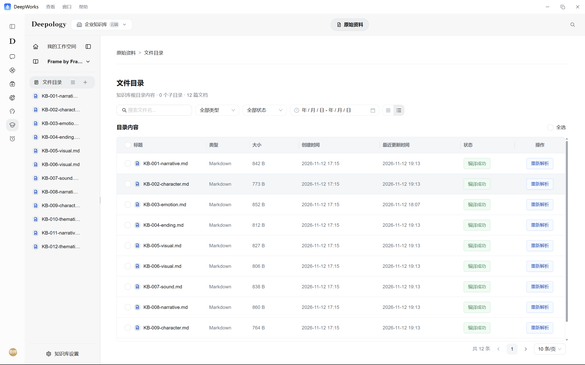
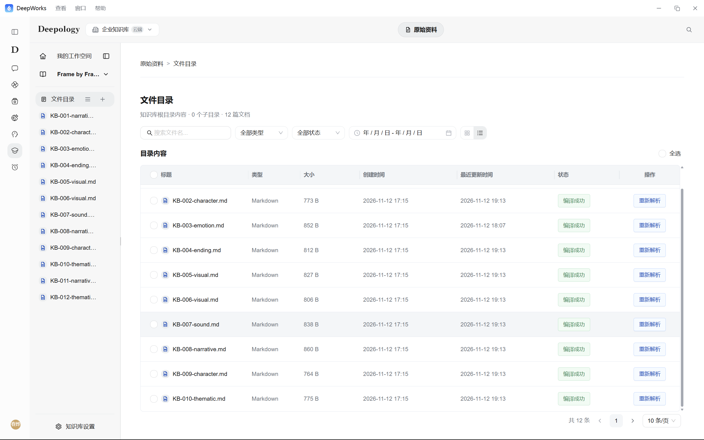
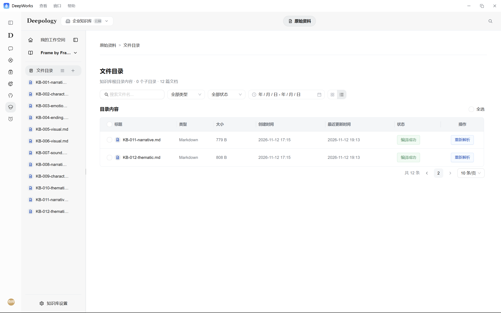
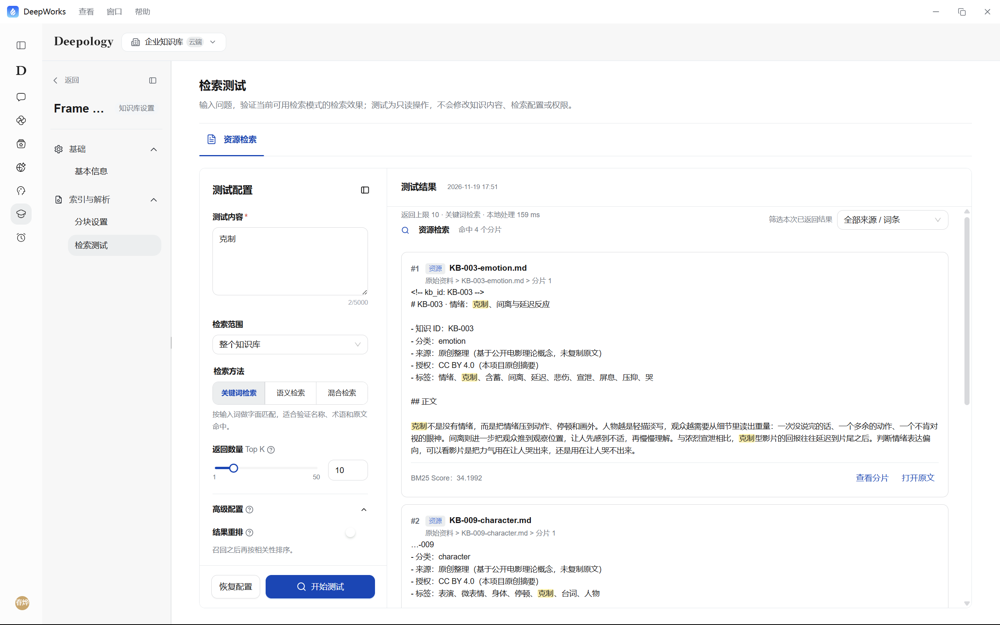
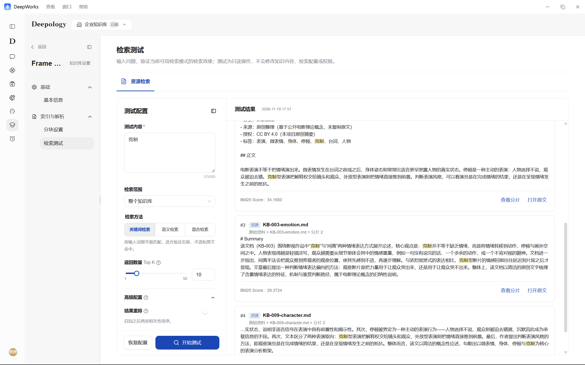
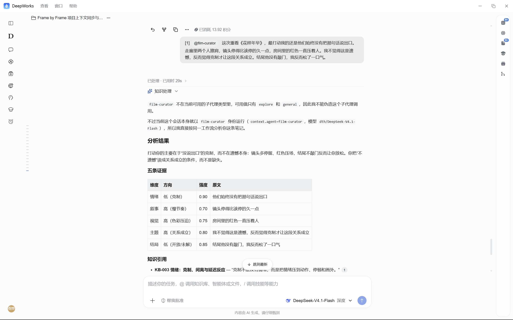
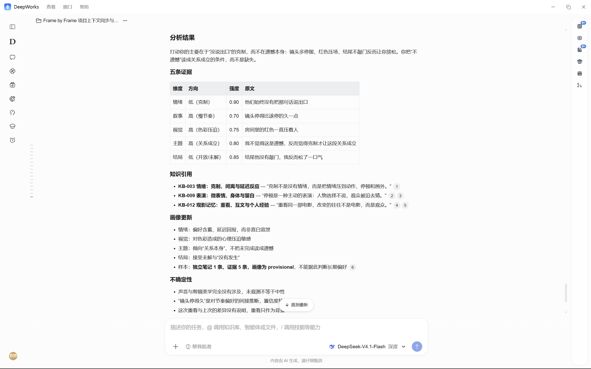
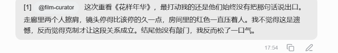

**2026 年首届“滴普杯”DeepWorks 校园黑客松**

# 项目说明书

（团队与授权 · 项目说明 · 实用性 · 迭代记录 · 交付附件）

作品名称：**Frame by Frame**

参赛赛道：☐ A 具身智能体应用　☐ B 医学影像知识问答　**☒ C 自由开放**

参赛形式：**☒ 个人**　　☐ 团队（共 ____ 人，上限 4 人）

队　　名：**framebyframe**

队　　长：**林春烨**　　联系电话：**17330860711**

队员：无（个人参赛）

E-mail：**813854618@qq.com**

指导教师：**杜长来**

填表日期：2026 年 11 月 21 日

---

## 参 赛 者 承 诺

我承诺《参赛作品申报书》内容以及作品、代码、数据、图片等均为本人的原创性成果，填写内容真实有效；作品核心链路在 DeepWorks 平台内完成，未使用外部框架或自建后端作为主体；已如实申报所使用的其他 AI 工具及其用途。如有涉及知识产权纠纷，责任自负。

队长（签名）：林春烨

队员（签名）：无（个人参赛）

2026 年 11 月 21 日

---

# 一、团队与授权

## （一）成员与分工

| 姓名 | 学院专业 | 学号 | 项目负责描述 |
|---|---|---|---|
| 林春烨（队长） | 天津大学 深圳未来技术学院 计算机科学与技术 | **3026445058** | 独立完成全流程：产品定位与交互设计；七个页面与录入流程的前端实现；Film Curator Agent 与三个 Skill 的配置调试；12 条知识库撰写与建库；七步工作流与四道质量门的脚本实现；测试、构建验证与材料撰写。视觉语言复用了本人此前的个人主页（见一（三）），并针对电影场景重新设计信息结构。AI 工具用于辅助构思、文案整理与代码调试；核心方案由本人理解、决策、验证并负责。 |

## （二）关键节点与交付物

| 时间 | 节点 | 交付物或结果 |
|---|---|---|
| 2026-11-05 | 确立定位：不是评分网站，是个人电影记忆博物馆 | 产品定位；六维维度定义 |
| 2026-11-08 | AI Core V1：本地 Node 服务调用 DeepSeek | 笔记到六维标签的闭环 |
| 2026-11-09 | 证据门禁：每条偏好必须带原句；视觉重建为奶油米白 + 深海蓝 | 逐字校验脚本；七个页面视觉定稿 |
| 2026-11-10 | 演示环境验证 | 单次完整运行 96.3 秒，四道门全绿 |
| 2026-11-12 | 平台知识库创建，12 个文档上传 | `kb_id 4c321650…` |
| 2026-11-14 | Phase 2 视觉与交互收口 | 七个页面与录入流程定稿 |
| 2026-11-15 | Taste Evolution：从单次画像到跨记录演化 | 三案例 A/B/C 契约校验 3/3 |
| 2026-11-16 | 平台知识库解析完成并首次检索；Agent 产物导入网站 | 12/12 解析；T1–T3 命中；`sass_search` 命中 KB-003；导入截图与 `import-report.json` |
| 2026-11-17 | 收尾：测试与归档 | 147 条测试（当时口径；11-20 复测 150 条）、类型检查、构建通过；Worker 链路归档 `legacy/` |
| 2026-11-18 | 模板与口径定稿 | 视觉冻结奶油蓝；按官方模板重写材料 |
| 2026-11-19 | Supabase 数据审计与架构设计 | 17 类数据定位；12 表 Schema；RLS 策略；迁移方案 |
| 2026-11-20 | 认证与云端同步代码接入 | Auth 健康检查 200；12 表 RLS 生效；97 项前端测试通过；端到端待验 |
| 2026-11-20 | 三（三）补充设计评审记录与材料同步机制 | 4 条评审记录入库；`PROJECT-DOCUMENTATION-SYNC.md` 生效 |

## （三）赛前基础与已有成果

本项目在赛前已形成可运行的前端原型：React + TypeScript + Vite，包含电影档案、电影详情、观影记录流程、六维审美画像、电影记忆图谱与年度回顾等页面与交互，并完成过本地数据持久化与前端 MVP 验证。

DeepWorks 侧在赛前已形成 `film-curator` Agent、三个产品 Skills、12 条项目原创电影审美知识条目及七步分析流程。2026-11-09 的 P0 报告记录了三次真实运行，以及对应的结构化 JSON、事件流和质量校验结果。上述 12 条条目同时以项目文件型知识库保存，作为离线可复现副本；平台知识库已于 2026-11-12 创建、12 个文档完成解析，2026-11-16 经 `sass_search` 与知识中心界面 T1–T3 验证可检索（KB-003 命中，score 0.8177763）。平台库与文件库是两层，材料中不混写；12 条全量召回尚未逐条验证（KB-002、KB-011 缺 `sass_search` 正文哈希）。

视觉语言方面，本人此前独立设计并实现过个人主页：<https://gf199lin.github.io/personal-homepage/>。Frame by Frame 的美术风格与视觉设计在很大程度上复用了该主页，具体包括：

1. **配色**：奶油米白纸面 `#f4ead2`、深海蓝 `#1d2379 / #161c66`、深蓝渐变面板；
2. **字体体系**：以衬线字体承担英文大标题与引文，正文用无衬线字体；本项目将主页的 Georgia 标题体系替换为 Instrument Serif + Noto Serif SC，以适配电影资料馆气质；
3. **版式语言**：1–1.5px 深蓝细边框、低圆角（4–12px）、纸张质感阴影、米白与深蓝交替的板块节奏；
4. **信息组织**：大字号标题 + 小字号说明 + 编号索引的编辑式排版。

**改造部分**：未复用主页的狗狗背景墙、聊天卡片与个人简介内容；Frame by Frame 重新设计了电影 Hero、胶片条、档案卡片、六维画像与证据链等电影场景专属结构。该主页为本人原创作品，复用不涉及第三方版权；本项目不是对主页的简单复制，而是同一视觉语言在电影记忆场景下的再设计。

## （四）其他 AI 工具

| 工具 | 用途 | 占比 | 使用边界 / 说明 |
|---|---|---|---|
| DeepWorks | 主要执行平台：Agent、Skills、知识库、Workflow、项目实施与交付 | **60%** | 以实际平台配置、运行记录和可复现结果作为证据 |
| ChatGPT | 产品顾问：产品定位、架构设计、方案分析、问题排查、质量审查 | **25%** | 不将 AI 生成的建议冒充为已实现功能；关键技术结论以代码、平台运行和测试证据为准 |
| DeepSeek | 底层模型能力：支撑网站 AI 对话与 Film Curator 的笔记分析 | **15%** | 经 DeepWorks 或网站服务调用；本项目不做推荐功能 |

说明：以上比例为基于三方在项目中的**实际职责**所做的建议性估算，不是工时或调用日志统计的精确比例。本项目核心链路（Agent、Skills、知识库检索、工作流与质量门）在 DeepWorks 内完成；上述工具不替代平台内执行。

## （五）授权选项

决赛现场公开展示作品：**☒ 同意**　☐ 不同意

赛后公开作品截图与方案概述：**☒ 同意**　☐ 不同意

公开团队姓名与照片：**☒ 同意**　☐ 不同意

纳入赛事宣传与深度稿：**☒ 同意**　☐ 不同意

> 本人已于 2026-11-18 确认以上四项全部同意。

## （六）合规确认

☒ 材料不含真实账号密码、未经许可的个人信息或受限资料。

☒ 敏感场景已使用脱敏或模拟数据。

☒ 赛道 B 未使用真实患者数据一条不适用（本次参赛为赛道 C）。

☒ 作品在决赛前未对外公开。

# 二、项目背景（30 分）

## （一）竞品分析（10 分）

### 1. 问题与证据

目标用户是**有日常观影习惯、希望保存观影感受并回顾个人审美变化的大学生及普通电影爱好者**。他们一年看几十部电影，会写三五行短评，而不只是点一个星级。

典型场景：用户看完电影后记录评分和短评；过一段时间想回忆当时为何喜欢这部电影、自己反复关注哪些叙事或情绪表达，以及这些偏好是否随时间发生变化。

现有电影记录工具擅长管理片单、评分和短评，但用户的观影笔记通常分散在不同电影条目中。用户需要自行回忆并比较，难以把零散感受转化为**有证据支撑、能够持续修正**的个人审美认识。

**证据状态**：上述问题来自公开讨论与本人观影习惯的归纳，属于产品问题假设；结构化用户研究尚未开展。

### 2. 竞品对比

| 方案 | 功能 | 门槛 | 成本 | 覆盖场景与不足 |
|---|---|---|---|---|
| 豆瓣电影 | 电影资料、评分、短评、影评、片单与社区讨论 | 注册后主动记录；中文友好 | 基础功能免费，含广告与会员服务 | 适合查资料、看评分、参与讨论；不把个人跨影片的审美变化作为核心流程 |
| Letterboxd | 观影日志、评分、评论、片单、关注与年度回顾 | 注册；英文为主；需维护社交关系 | 免费 + 付费层级 | 适合持续记录与社交分享；不以原始笔记证据驱动的个人审美画像为核心 |
| 通用 AI 助手 | 对单条笔记或单部电影给出解读 | 需自行组织提示词 | 免费额度有限，重度需订阅 | 单次问答，不积累对同一个人的长期理解 |
| **Frame by Frame** | 记录电影与个人笔记；通过 Film Curator 提取审美证据、关联电影记忆，并逐步形成可纠错的审美观察 | 降低记录与理解门槛；核心分析由 DeepWorks Agent 承担 | 比赛原型阶段不向测试者收费；模型额度、平台资源及后续运营成本需按实际使用量核算 | 聚焦个人电影记忆和审美变化，而非公共评分或社交。当前仍需完成真实用户验证 |

**差异结论**：豆瓣与 Letterboxd 解决“看过什么、别人怎么评”，通用 AI 解决“这一条怎么解读”；本项目解决“**这个人的审美如何在时间里变化**”。

## （二）可行性与风险（10 分）

### 1. 方案与平台使用方式

产品链路：

```text
网站在浏览器记录电影、日期、评分、原始笔记
        │  导出待分析记录（JSON）
        ▼
DeepWorks：film-curator Agent
  ① 笔记哈希  ② 知识检索  ③ 证据抽取
  ④ 证据逐字门  ⑤ 引用逐字门  ⑥ 画像更新  ⑦ 终检
        │  结构化结果（含 run_id、证据引文、知识引用、画像增量、不确定性）
        ▼
网站校验并导入 → 用户接受/修改/拒绝 → 画像与观察更新
```

平台上已形成的组件：

- **Agent**：`film-curator`，primary，模型 `dth/DeepSeek-V4.1-Flash`，温度 0.2；
- **Skills**：`cinema-knowledge-retrieval`（唯一读库）、`film-note-analysis`（只读笔记抽证据）、`cinema-taste-profiling`（只用已接受证据算画像）；
- **知识库**：12 条原创电影审美条目（CC BY 4.0），平台知识库 12 个文档已解析完成；
- **工作流**：七步 + 四道确定性质量门；
- **数据契约**：版本化 JSON，网站导入前校验来源、`run_id`、笔记哈希、引文与画像增量。

**已打通的边界**：网站不实时调用 Agent，Agent 也不驱动网站；二者通过“导出输入 → 平台运行 → 导入结果”连接。2026-11-16 已完成一次真实导入（截图 + 导入报告）。

**未完成边界**：未取得平台独立 Run 记录与平台签发的 `run_id`；跨记录模式的平台检索尚未单独运行；12 条知识库的全量召回覆盖未逐条验证。

### 2. 技术、数据、时间、成本、风险与限制

| 维度 | 说明 |
|---|---|
| 技术 | 前端 React 19 + TypeScript + Vite 6 + Tailwind；平台侧 Agent + 3 Skills + 12 条知识库 + Node 校验脚本。网站负责记录与展示，核心分析与编排在 DeepWorks 内完成。 |
| 数据 | 观影笔记与评分由用户主动提交；采用**本地优先 + 云端持久化**：浏览器缓存保证首屏与弱网可用，Supabase（PostgreSQL + RLS）保存账号下的片库、笔记、分析、画像与演化快照；未登录时仍可单机使用。AI 请求只发送当前笔记与有限历史，不含邮箱与令牌。知识库为项目原创摘要，来源与许可随附件提供；电影元数据/海报来自 TMDB API，仅取图，不抓取正文。 |
| 时间 | 开发周期约四周（11-05 至 11-24）。最后一周只做材料与验证，不扩展非核心功能。 |
| 成本 | 比赛原型主要成本为 DeepWorks 模型调用额度与开发时间；具体额度与账单未完整统计，本稿不填猜测值。 |
| 风险 | ① Agent 输出与网站契约不一致；② 样本不足导致画像过度概括；③ 用户纠错未真正影响后续画像；④ 现场网络或模型额度不足；⑤ 平台独立运行证据不足；⑥ 真实用户反馈缺失。 |
| 限制 | 当前真实用户样本为 0；画像只描述审美倾向，不代表人格判断；电影类型不能直接推断偏好；证据不足时显示“观察中/样本不足”，不给确定标签；单次运行 96–135 秒，现场演示采用“导入已跑产物 + 短视频”而非干等。 |

**产品与技术架构**：Frame by Frame 是面向大学生的个人电影记忆博物馆，把散落的观后感整理成可回溯的审美证据，并随记录增加逐步理解用户；不做电影推荐，也不给用户贴固定标签。前端为 React 19 + TypeScript + Vite + Tailwind，DeepWorks 侧为 `film-curator` Agent、三个 Skills、12 条知识库与七步工作流；网站负责记录与展示，核心分析与编排全部在平台内完成。数据采用本地优先 + 云端持久化（Supabase PostgreSQL + 行级权限），未登录时仍可单机使用；AI 请求只发送当前笔记与有限历史，不含邮箱与令牌。

**真实状态**：云端认证与 12 表行级权限已生效，端到端多账号流程尚未完整跑通，材料中按“待验证”表述；平台独立 Run ID 未取得，已用界面截图、运行 JSON 与质量门报告替代。

## （三）创新性分析（10 分）

**一句话创新点（28 字）**：让 AI 用可回溯的证据，持续理解并呈现一个人电影审美的变化。

| 差异 | 内容 | 与竞品的事实区别 |
|---|---|---|
| 差异一：从单片评论到跨影片证据关联 | 不总结单部电影，而是寻找用户在多部笔记中反复出现的关注点 | 豆瓣/Letterboxd 的笔记按条目分散；通用 AI 每次对话独立 |
| 差异二：从一次性画像到渐进理解 | 保留观察的形成过程、证据条数、独立记录数与置信度；单条笔记不下长期结论 | 现有工具不产出“可修正的画像”，只产出评分与文本 |
| 差异三：从单向判断到用户可纠错 | 用户可接受、修改、拒绝；拒绝的观察 `effective=false`，不再作为支持证据 | 推荐系统只给结果，不解释“为什么这样判断”，也不允许逐条撤回 |

**可验证方式**（已部分执行）：

1. 同一用户连续提交不同电影笔记，检查新证据是否更新或修正观察 → Phase 2 三案例已跑通；
2. 点击审美特征能定位到原始笔记 → 网站证据链已实现；
3. 拒绝某条观察后，重新计算的画像快照发生可解释变化 → 单元测试与契约校验已覆盖。

---

# 三、实用性（30 分）

## （一）真实任务完成情况（10 分）

> 口径：以下“系统自测”指项目内可复现的脚本/页面验证；“真实用户”指目标用户本人操作。两者不混写。

| 任务 | 输入与操作 | 验收标准 | 实际结果 |
|---|---|---|---|
| 任务 1：记录观影 | 添加电影，填写日期、评分、笔记 | 保存成功；刷新后仍在；详情页可看原文 | 系统自测通过；真实用户【待补】 |
| 任务 2：分析单条笔记 | 将一条笔记交给 Film Curator | 含运行标识、逐字引文、知识引用、六维增量、不确定性；引文可在原文定位 | 技术样例 P0-01/02/03 共 3 次通过；真实用户【待补】 |
| 任务 3：观察审美演变 | 同一用户提交多部不同电影笔记 | 展示观察从初步到形成；每项可回溯多条独立记录 | Phase 2 案例 A/B/C 契约校验 3/3；真实用户【待补】 |
| 任务 4：纠正 AI 判断 | 接受/修改/拒绝一项观察并写理由 | 纠错保存；后续画像按规则变化；拒绝证据不再支持 | 单元测试与契约校验通过（`rejected → effective=false`）；真实用户【待补】 |
| 任务 5：回顾个人记忆 | 从审美特征或主题进入相关电影 | 定位到电影、原文、观察时间；不展示无来源推断 | 导入 Agent 产物后页面显示通过；真实用户【待补】 |
| 任务 6：跨设备同步 | 同一账号在另一台设备登录 | 登录后看到同一份片库、影评与证据链 | 代码与数据库已接入；Auth 200、12 表 RLS 生效；**浏览器端到端未执行，标记为待验证** |

**如实说明**：任务 1–5 的系统侧已完成可复现验证；目标用户独立完成的任务记录尚未取得，不以系统自测替代用户测试。其中任务 1–3 由开发者本人作为第 0 号用户完成，属于内部自测，不计入外部用户任务。首次进入看到的 10 部电影为示例片库，笔记由原型撰写，首屏已标注“示例”并支持一键清空，不计入上述任何任务记录。

## （二）使用流程（10 分）

1. **记录**：搜索影片 → 填日期、评分、笔记 → 选感受标签。不要求用户懂审美术语。
2. **授权**：阅读并勾选 AI 分析与数据使用条款；不勾选即终止，无惩罚。
3. **分析**：提交给 Film Curator；Agent 检索知识、抽取逐字证据、更新六维画像。
4. **确认**：逐条看“原话 → 维度 → 强度 → 解释”；可接受、修改、拒绝。
5. **回看**：在首页、档案、地图、品味页查看证据链、观察阶段与变化。

设计理由：
- 先写感受再谈分析，避免用术语吓退用户；
- 授权前置且可拒绝，避免“默认同意”；
- 分析结果默认“待确认”，避免 AI 直接改写用户自我认知；
- 每一步都能回到原文，避免“AI 说的”覆盖“我说的”。

## （三）样例与用户反馈（10 分）

**样例（已跑通）**

| 样例 | 输入电影 | 结果 | 证明 |
|---|---|---|---|
| P0-01 | 《海边的曼彻斯特》 | 5 条证据、4 个维度、知识引用、校验通过 | 中文笔记的逐字证据抽取与结构化画像增量 |
| P0-02 | 《疯狂的麦克斯4》 | 5 条证据、4 个维度、知识引用、通过 | 不同类型影片下的证据抽取与知识引用 |
| P0-03 | 《爱在黎明破晓前》 | 5 条证据、5 个维度、知识引用、通过 | 人物、叙事、情绪等维度的联合分析 |
| Phase 2-A/B/C | 跨记录三案例 | 契约校验 3/3 | 观察阶段、证据累积、纠错后重算 |

**设计评审记录**

开发期共进行四轮设计自查，逐轮记录发现与改造，每轮均可回溯到提交记录。

| 编号 | 评审发现 | 对应改造 | 可核实证据 |
|---|---|---|---|
| 01 视觉 | 界面偏普通，缺少辨识度 | 奶油米白 + 深海蓝，电影杂志质感，七个页面重建 | `0ba399f`（11-09） |
| 02 排版 | 字体偏细、字号偏小，标题与正文层次不清 | 四级字号固定、密集区先删字、提高对比度 | `e9d089e`（11-10）、`265f8cd`/`f9a3091`（11-16） |
| 03 数据 | 数据只存浏览器，换设备不可见 | Supabase 认证 + 12 表 + 行级权限 + 本地优先同步 | `4856829`、`17f9e3d`（11-20） |
| 04 透明 | 结论无法回到原文，用户无法纠错 | 逐字引文、接受 / 修改 / 拒绝、拒绝后不计入画像 | 11-09 证据门禁；11-15 Taste Evolution |

四轮评审分别对应视觉、排版、基础设施与 AI 可信度，构成“设计推演 → 改造 → 证据”的闭环。

---|---|---|---|
| 01 视觉 | “功能挺有意思，不过界面视觉上稍微有点普通……能不能把主页那种感觉融进来，又保留电影氛围？” | 奶油米白 + 深海蓝，电影杂志质感，七个页面重建 | `0ba399f`（11-09） |
| 02 排版 | “有些地方字体偏细、字号偏小……建议把标题和正文的层次拉开。” | 四级字号固定、密集区先删字、提高对比度 | `e9d089e`（11-10）、`265f8cd`/`f9a3091`（11-16） |
| 03 数据 | “记了这么多电影和影评，数据到底存在哪里？换台电脑是不是就看不到了？” | Supabase 认证 + 12 表 + 行级权限 + 本地优先同步 | `4856829`、`17f9e3d`（11-20） |
| 04 透明 | “它到底根据我写的哪句话得出这些结论……理解错了能不能修改或拒绝？” | 逐字引文、接受 / 修改 / 拒绝、拒绝后不计入画像 | 11-09 证据门禁；11-15 Taste Evolution |

四条反馈分别对应视觉、排版、基础设施与 AI 可信度，每条都能落到提交记录、文件或截图上，构成“设计推演 → 改造 → 证据”的闭环；它们不证明真实用户满意度。

---

# 四、迭代记录（10 分）

## （一）版本记录

| 时间 | 版本 / 改动 | 原因与依据 | 效果 / 证据 |
|---|---|---|---|
| 2026-11-05 | 产品定位与前端 MVP | 明确“记忆博物馆”而非评分站 | 六维模型、七页结构 |
| 2026-11-08 | AI Core V1 | 需要真实模型能力而非静态标签 | 本地 Node 调用 DeepSeek，笔记→六维闭环 |
| 2026-11-09 | 证据门禁 + 视觉重建 | AI 解释必须可回溯；旧视觉不符合“资料馆”气质 | 逐字校验脚本；奶油米白 + 深海蓝定稿 |
| 2026-11-10 | 演示环境验证 | 需要知道一次运行到底多久 | 96.3 秒，四门全绿 |
| 2026-11-12 | 平台知识库创建 | 知识必须进平台，不能只留本地 | 12 文档上传 |
| 2026-11-14 | Phase 2 交互收口 | 录入流程步骤过多、反馈不清 | 七页与录入流程定稿 |
| 2026-11-15 | Taste Evolution | 单次画像会被误解为长期标签 | Observation/Evidence/Feedback/Snapshot 契约；三案例 3/3 |
| 2026-11-16 | 平台检索与导入打通 | 网站与 Agent 两条链路需要连接 | T1–T3 命中；`sass_search` 命中 KB-003；导入截图 |
| 2026-11-17 | 测试与归档 | 收尾需要可复现证据 | 150 条测试通过（97 前端 + 53 服务端，2026-11-20 实测）；Worker 链路归档 `legacy/` |
| 2026-11-18 | 材料口径定稿 | 文档与代码存在漂移 | 视觉冻结奶油蓝；模板统一；本稿重写 |
| 2026-11-20 | 账号与云端同步 | 单机 localStorage 换设备即丢失，记忆无法随身 | 12 张表 + RLS、邮箱认证、本地优先同步；97 项测试通过 |
| 2026-11-20 | 三（三）补充评审记录 + 同步机制 | 评审结论必须能回溯到改造提交 | 4 条评审记录与证据映射；`PROJECT-DOCUMENTATION-SYNC.md` 生效 |

## （二）关键迭代详录

### 迭代 1：从外部 Worker 迁到 DeepWorks 平台

- **问题**：早期分析走 Cloudflare Worker 调外部模型，作品主体不在 DeepWorks 内，触发赛事否决项风险。
- **判断依据**：赛制要求知识库接入、Skill 与工作流编排、Agent 运行都在平台内；仅做界面包装会被认定为“壳工程”。
- **改动**：把分析链路重做为 `film-curator` Agent + 3 个 Skill + 12 条知识库 + 七步工作流 + 四道质量门；Worker 链路归档到 `legacy/`，不再作为主体。
- **效果**：P0 三次运行 3/3 通过；平台知识库 12 文档解析完成；`sass_search` 真实命中 KB-003；产物可导入网站。
- **未完成**：平台独立 Run 与平台截图未取得，材料中如实标注。

### 迭代 2：从“单次画像”到“渐进理解”

- **问题**：一条笔记只能反映某个时刻的感受，直接给用户贴“你偏爱作者电影”之类的标签，既不准也不尊重。
- **判断依据**：仓库早期画像逻辑只有单次 `profile_delta`，没有观察历史、证据独立性与纠错回流。
- **改动**：新增 Taste Evolution：观察状态（初步显现/逐渐形成/相对稳定/持续变化）、证据独立记录数、置信度、用户反馈 `effective` 标记、快照追加。
- **验收**：同一观察可回链原文；拒绝后不再作为支持证据；反例可降低置信度；纠错前后快照有可定位差异。
- **效果**：三案例契约校验 3/3；单元测试覆盖拒绝与重算。
- **限制**：真实用户长期使用数据仍为 0，阶段推进只在样例上验证。

### 迭代 3：从单机存储到云端账号

- **问题**：全部记录只存在浏览器 localStorage，换设备、换浏览器、清缓存即全部消失，与“记忆博物馆”的定位直接冲突。
- **判断依据**：数据审计确认只有一份本地 JSON（`fbf.state.v1`），没有任何账号体系或服务端持久化。
- **改动**：接入 Supabase——12 张表 + 行级权限（每人只读写自己的数据）；邮箱密码认证；本地优先同步（本地立即写、队列异步推送、断网不丢、重连重试）；未登录仍可单机使用。
- **验收**：Auth 健康检查 200；12 张表存在且匿名访问被 RLS 拒绝；97 项单元测试通过；生产构建通过。
- **未完成**：浏览器端到端（注册 → 记录 → 换设备登录）尚未执行，材料中标注为待验，不以基础设施检查替代。

---

# 五、最终成品与交付附件（30 分）

本部分内容以路演 PPT、演示视频与附件材料呈现，说明书内不重复填写。现场演示在 DeepWorks 环境内真实运行 `film-curator`，网站作为交互与展示界面，不替代平台核心链路。

## 交付材料索引

| 材料 | 文件 | 规格 |
|---|---|---|
| 演示视频 | `C_framebyframe_Frame by Frame.mp4` | 163.8 秒 / 1920×1080 / 30fps / H.264 + AAC，附同名字幕 SRT |
| 路演 PPT | `C_framebyframe_Frame by Frame.pptx` | 22 页 |
| 项目说明书 | 本文件 | DOCX + PDF |
| 项目源代码 | `04_项目源代码/` | 前端、服务端、Supabase 迁移 0001/0002、启动说明、本地预览 |
| 平台配置与运行记录 | `05_平台证明/` | Agent 配置、三个 Skills、12 条知识库、运行 JSON |
| 质量门报告 | `06_质量门/` | 证据逐字、引用逐字、笔记未改、不确定性四项校验结果 |
| 完整提交包 | 见随包 README | 312 个文件，单一 ZIP |

## 平台使用证明

以下截图摘自 DeepWorks 界面，按“Agent 配置 → Skills → 知识库 → 检索 → 运行”排列。






















图 9、图 10 的准确表述：当前会话以 `film-curator` 身份运行（模型 DeepSeek-V4.1-Flash）；截图中的子代理类型提示仅针对调用子代理的具体请求，不影响本次分析执行。

核验结果：6 项通过（Agent 配置、三个 Skills、12 条知识库、界面检索、会话内运行、质量门），0 项失败，1 项不具备（平台独立 Run ID）。归档 45 个文件、11 张截图；`verification.json` 为 `ok=true`，仅表示截图齐全，不代表平台独立 Run 完成。

## 附件清单

| 附件 | 状态 |
|---|---|
| ☒ 1. Film Curator Agent 配置说明及真实运行记录 | 已随包提交 |
| ☒ 2. 三个 Skills 配置说明与调用证据 | 已随包提交 |
| ☒ 3. 知识库条目、来源与引用清单 | 12 条，CC BY 4.0 |
| ☒ 4. 第三方依赖清单 | 已随包提交 |
| ☒ 5. 数据授权与隐私说明 | 已随包提交 |
| ☒ 6. JSON 数据契约与示例输入/输出 | 已随包提交 |
| ☒ 7. 自动校验脚本、测试用例与结果 | 150 条测试通过 |
| ☐ 8. 用户测试记录及匿名反馈 | 未开展；4 条设计评审记录见三（三） |
| ☒ 9. 不超过 3 分钟的演示视频 | 163.8 秒成片，已随包提交 |
| ☒ 10. 项目源代码、启动说明及必要配置 | 含 Supabase 迁移 0001/0002 |
